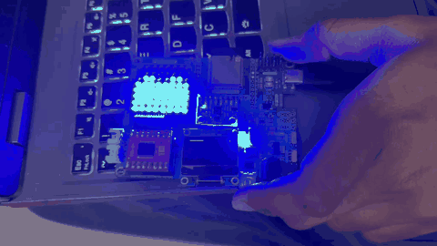
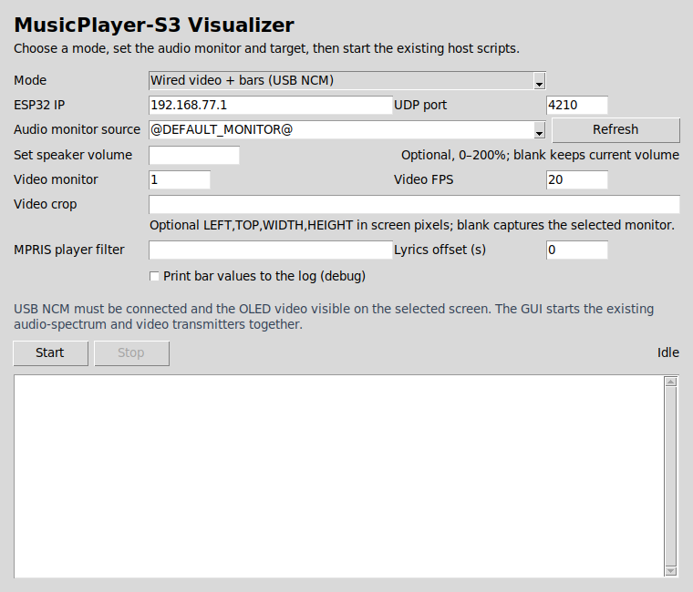

# MusicPlayer-S3

Turn a YouTube video playing on a Linux computer into a display for an ESP32-S3:

- A 128×64 SSD1306 I²C OLED shows either a reduced copy of the visible video or timed lyrics.
- An 8×8 MAX7219 matrix shows audio-reactive bars.
- The computer captures the speaker output, analyzes it locally, and sends only eight bar heights. The ESP32 never receives or plays audio.
- USB network (NCM) is the wired transport for OLED/video/lyrics modes. Wi-Fi UDP is available for the matrix-only spectrum mode.

The project uses the existing display hardware. It needs no microphone, DAC, amplifier, or audio input circuit.

## SRA Board hardware reference

This visualizer targets the ESP32-S3 setup on the [SRA Board 2027 hardware project](https://github.com/VarunAPatil/Wall-E-2027-Board-Design/tree/main). That repository contains the board documentation and KiCad design files, including the MAX7219-driven 8×8 matrix. This repository contains the visualizer host programs and firmware. Use the hardware repository as the reference for the board itself, and check its schematic against the pin assignments below if your board revision differs.

## Demo



[Open the original 8.5-second MP4 demo](assets/demo.mp4).

## Project layout

```text
host/
  audio_volume.py                    optional pactl volume helper
  visualizer_gui.py                  Tkinter GUI for all host modes
  spectrum_transmitter.py            wired USB spectrum bars
  wireless_spectrum_transmitter.py   Wi-Fi spectrum bars
  youtube_lyrics_transmitter.py      USB timed lyrics plus spectrum bars
  video_transmitter.py               USB screen capture for the OLED
  run_visualizer.sh                  starts USB video and bars together
firmware/
  usb-ncm/                            USB NCM receiver, OLED, and MAX7219
  wifi-udp/                           Wi-Fi UDP MAX7219 receiver
assets/
  demo.mp4                            original project demo
  demo.gif                            inline README preview
requirements.txt
```

Each firmware directory is a separate ESP-IDF project. Flash the project that matches the host script you plan to use. `usb-ncm` supports the wired spectrum, lyrics, and video modes. `wifi-udp` supports wireless spectrum bars on the MAX7219; it does not provide OLED video or lyrics.

## Hardware and pins

Use the ESP32-S3 connections for this SRA Board setup:

| Display | ESP32-S3 pin |
| --- | ---: |
| MAX7219 CLK | GPIO18 |
| MAX7219 DIN | GPIO16 |
| MAX7219 LOAD/CS | GPIO17 |
| OLED SCL | GPIO21 |
| OLED SDA | GPIO14 |

The OLED firmware expects an SSD1306-compatible 128×64 display at I²C address `0x3C`. The MAX7219 matrix orientation differs across modules. Adjust `MATRIX_ROTATION`, `MIRROR_X`, `MIRROR_Y`, and `DIGITS_ARE_COLUMNS` near the top of the matching firmware `main.c` if needed. `CENTER_MIRROR` mirrors the four audio pairs outward, putting the bass bands in the two center columns.

## Requirements

### Linux host

Install the system tools and create the Python environment:

```bash
sudo apt update
sudo apt install python3 python3-venv python3-pip python3-tk pulseaudio-utils
python3 -m venv .venv
.venv/bin/pip install -r requirements.txt
```

Run these commands from the root directory of your cloned repository.

`pulseaudio-utils` provides `pactl` and `parec`. They work with PulseAudio and with PipeWire through its PulseAudio compatibility server. Python packages are:

- `numpy`: FFT and band-energy calculations
- `mss`, `Pillow`: visible-screen capture and conversion to OLED pixels
- `dbus-next`: read current browser playback metadata for synced lyrics

The lyric mode also needs a desktop session D-Bus and an MPRIS-capable browser player. It asks LRCLIB for synced lyrics over the internet. Lyric availability and matching vary by song. The video mode needs a graphical desktop session accessible to MSS. Screen-capture behavior depends on the desktop environment; on Wayland, permissions or portal behavior can prevent capture.

`python3-tk` supplies Tkinter for the desktop app; it is an OS package, not a pip dependency. All actual capture, FFT, video conversion, and UDP transmission remain in the existing host scripts.

### ESP-IDF

Install ESP-IDF 5.1 or newer with ESP32-S3 support by following [Espressif's Get Started guide](https://docs.espressif.com/projects/esp-idf/en/latest/esp32/get-started/). Activate the environment for your installation method. For a standard source checkout on Linux or macOS, source its `export.sh` script, replacing the example path with your ESP-IDF directory:

```bash
source /path/to/esp-idf/export.sh
```

The `usb-ncm` project downloads its ESP TinyUSB managed component on the first build. No Arduino display library is used; its OLED and MAX7219 drivers are part of the project. The Wi-Fi receiver uses ESP-IDF's built-in Wi-Fi and SPI drivers.

## Run the GUI (recommended)

Start the graphical launcher from the project root:

```bash
.venv/bin/python host/visualizer_gui.py
```

Choose one of four modes: wired video plus bars, wired lyrics plus bars, wired bars only, or wireless bars only. The GUI starts and stops the existing transmitter scripts; it does not reimplement their capture or packet logic. The wired modes require the `usb-ncm` firmware and connected USB network link. Wireless bars require the `wifi-udp` firmware and its current IP address.



The controls are:

- **ESP32 IP / UDP port:** USB NCM defaults to `192.168.77.1:4210`; for Wi-Fi, enter the address printed by the ESP32 firmware.
- **Audio monitor source:** Refresh to list PulseAudio/PipeWire `.monitor` sources, or type one. `@DEFAULT_MONITOR@` follows the default output. This is output capture, not microphone capture.
- **Set speaker volume:** Optional 0–200% setting applied through `pactl` to the current default sink. Leave blank to keep the current volume.
- **Video monitor / FPS / crop:** Used in video mode. Monitor numbering starts at 1. Crop is optional `LEFT,TOP,WIDTH,HEIGHT` screen pixels; blank captures the selected monitor.
- **MPRIS player filter / lyrics offset:** Used in lyrics mode. The filter can select a browser/player by name; offset adjusts lyric timing in seconds.
- **Debug:** Prints the eight bar heights periodically for spectrum modes.

After selecting a mode and settings, click **Start**. Captured process output appears in the log panel; **Stop** terminates the transmitter process group, including the spectrum child used by lyrics mode. For lyrics, start YouTube playback in an MPRIS-capable browser before starting the sender. For video, keep the visible YouTube player unobscured within the selected screen or crop.

If the source dropdown is empty, check that `pactl` works in the same desktop session and use the CLI source listing below. Tkinter may also need a working graphical session; on Wayland, screen capture permissions can affect video mode.

## Mode options and CLI backup

| Goal | Firmware to flash | GUI mode | CLI command |
| --- | --- | --- |
| Wireless sound bars on the matrix | `firmware/wifi-udp` | Wireless bars only | `.venv/bin/python host/wireless_spectrum_transmitter.py --ip ESP_WIFI_IP` |
| Wired sound bars on the matrix | `firmware/usb-ncm` | Wired bars only | `.venv/bin/python host/spectrum_transmitter.py` |
| Wired timed YouTube lyrics on OLED plus sound bars | `firmware/usb-ncm` | Wired lyrics + bars | `.venv/bin/python host/youtube_lyrics_transmitter.py` |
| Wired visible video on OLED plus sound bars | `firmware/usb-ncm` | Wired video + bars | `host/run_visualizer.sh` |

Only one firmware image runs at a time. The `usb-ncm` firmware exposes its USB network interface and listens for all three wired packet types on UDP port 4210.

## Flash the firmware

### USB NCM firmware (bars, lyrics, or video)

From the repository root, enter the firmware project directory. Connect the ESP32-S3's native USB port. Enter ROM download mode with BOOT held while tapping RESET/EN, then release BOOT. Build and flash:

```bash
cd firmware/usb-ncm
idf.py set-target esp32s3
idf.py build
idf.py -p YOUR_SERIAL_PORT flash
```

Replace `YOUR_SERIAL_PORT` with the port for your board. On Linux, list likely ports with `ls /dev/ttyACM* /dev/ttyUSB*`. After flashing, release BOOT and tap RESET/EN to start the app. The running firmware presents a USB Ethernet/NCM device, usually shown as an interface named `enx...`.

USB NCM uses the ESP32-S3 USB-OTG TinyUSB controller. The USB-Serial/JTAG controller shares its internal PHY, so the NCM build disables the secondary USB-Serial/JTAG console. The NCM link is the data interface; use ROM download mode for flashing and logging during this build. See Espressif's [ESP32-S3 USB device documentation](https://docs.espressif.com/projects/esp-usb/en/latest/esp32s3/usb_device.html).

The USB link addresses are fixed in firmware:

- ESP32-S3: `192.168.77.1/30`
- Linux computer: `192.168.77.2/30`
- UDP port: `4210`

Most Linux network managers configure the host side automatically. If the interface appears without an IPv4 address, find it with `ip -br link` and assign the address (replace `enx...`):

```bash
sudo ip address replace 192.168.77.2/30 dev enx...
sudo ip link set enx... up
ping -c 3 192.168.77.1
```

USB NCM (Network Control Model) makes the ESP32-S3 appear to Linux as an Ethernet network adapter over the USB cable. The ESP-IDF firmware uses TinyUSB's NCM device support and assigns the ESP32 `192.168.77.1/30`; the host uses `192.168.77.2/30`. UDP is routed over that point-to-point network link. The cable carries network packets, not a serial text stream. The host sender binds UDP to the NCM interface (identified by its configured MAC address) so packets do not accidentally leave over Wi-Fi. The same USB connection is also used to flash in ROM download mode, but the running NCM app owns the data interface.

The sender auto-detects the NCM interface by its MAC address. To select it manually, pass `--interface enx...` to the host program.

### Wi-Fi spectrum firmware

Edit `WIFI_SSID` and `WIFI_PASSWORD` in `firmware/wifi-udp/main/main.c`, then, from the repository root, build and flash:

```bash
cd firmware/wifi-udp
idf.py set-target esp32s3
idf.py build
idf.py -p YOUR_SERIAL_PORT flash monitor
```

The monitor prints the ESP32's DHCP address after connection. Use that address for the host's `--ip`. The laptop and ESP32 must be on the same reachable LAN; guest Wi-Fi/client isolation can block UDP even when both devices have internet access. Exit the monitor with Ctrl-].

## Find the system-audio monitor source

The transmitter records an output monitor source, not a microphone. List available sources:

```bash
pactl list short sources
```

Choose the source whose name ends in `.monitor`, usually associated with the active speaker output. For example:

```text
YOUR_OUTPUT_NAME.monitor
```

Check the active output and default monitor:

```bash
pactl info
pactl get-default-sink
pactl list short sources
pactl get-default-sink | xargs -I{} pactl get-sink-volume {}
```

The programs default to `@DEFAULT_MONITOR@`, so switching the system's default output normally selects the matching monitor. If that alias is unavailable or the wrong output is selected, pass the exact `.monitor` source with `--source`:

```bash
python host/spectrum_transmitter.py --source YOUR_OUTPUT_NAME.monitor --debug
```

Use `--list-sources` on any spectrum or lyrics transmitter to print source names. The monitor may report `SUSPENDED` while no application is producing audio; that is normal. Start YouTube playback and verify that the monitor signal changes before debugging the ESP32.

## Volume option

The host scripts can optionally set the default speaker sink volume using:

```text
pactl set-sink-volume @DEFAULT_SINK@ PERCENT%
```

Pass a percentage as a command-line argument. For example:

```bash
python host/spectrum_transmitter.py --volume 120
host/run_visualizer.sh --volume 150%
python host/youtube_lyrics_transmitter.py --volume 100
```

`--volume` accepts values from `0` to `200`, with or without `%`. If omitted, volume is unchanged. Values above 100% are software amplification; they may distort or clip the sound and can be loud. The setting applies to the current default sink, not to a particular application stream.

### CLI details

The GUI is the normal way to start a mode. These command-line forms are available for scripting, troubleshooting, and headless use. Run from the project root using `.venv/bin/python`.

### Wireless spectrum bars

After flashing `wifi-udp` and noting the address printed by `idf.py monitor`:

```bash
.venv/bin/python host/wireless_spectrum_transmitter.py --ip ESP_WIFI_IP --volume 120 --debug
```

Change the address and optional port to match your network. Stop with Ctrl-C. The UDP packet is eight comma-separated integers, such as `7,4,2,6,8,5,3,1`.

### Wired spectrum bars

With `usb-ncm` flashed and the NCM link connected:

```bash
.venv/bin/python host/spectrum_transmitter.py --debug
```

The program captures the speaker monitor and sends roughly 50 small UDP packets per second. Use `--ip`, `--port`, `--source`, or `--interface` to override defaults.

### Wired lyrics and bars

Start a YouTube song in a browser that exposes playback over MPRIS, then run:

```bash
.venv/bin/python host/youtube_lyrics_transmitter.py --player chromium --volume 120
```

Use `--player firefox` or a substring of the MPRIS player name if needed. `--offset 0.4` shifts lyric timing 0.4 seconds later; a negative offset moves it earlier. `--no-spectrum` sends lyrics without starting the audio capture process. `--list-sources` lists monitor sources.

The OLED firmware displays the track title and wraps lyric text across the screen. The program polls browser playback position, searches LRCLIB for synchronized lyrics when the track changes, then sends only the current title and line. It does not retrieve or decode YouTube media. LRCLIB's [API](https://lrclib.net/docs) has synced lyrics for some, not all, tracks, so an unmatched song shows “No synced lyrics found.”

### Wired visible video and bars

Put the YouTube video in a visible browser window, then run:

```bash
host/run_visualizer.sh --volume 120
```

The script starts the audio analyzer and video capture together. It samples the selected screen and scales each screenshot to monochrome 128×64 pixels for the OLED. If the video is not filling the monitor, restrict capture to the video player with a screen region:

```bash
host/run_visualizer.sh --region 300,150,900,500 --volume 120
```

The region syntax is `LEFT,TOP,WIDTH,HEIGHT` in screen pixels. Use `--monitor 2` to capture another monitor, `--fps 15` to reduce frame traffic, or `--no-dither` for a hard black/white threshold. Dithering preserves more image detail on the monochrome screen. Since only visible frames are captured, keep the player unobscured and the display awake.

Audio bars update at about 50 Hz; video frames default to 20 Hz. Both travel over the same low-latency USB network link but use independent UDP packets and do not share a media timestamp. They stay close to live playback, but this is not frame-accurate audio/video synchronization.

## What the audio analyzer does

1. `parec` reads 48 kHz stereo float audio from the selected PulseAudio-compatible monitor source in small chunks. The two channels are analyzed independently enough to avoid cancellation if stereo channels have opposite phase; no audio samples are transmitted.
2. NumPy maintains an overlapping 2048-sample Hann-windowed frame and computes a real FFT about 50 times per second. The FFT gives frequency-bin magnitudes.
3. Bins from 40 Hz to 11 kHz are grouped into eight geometrically spaced ranges. This gives narrower bands at low frequencies and wider bands at high frequencies, which is a useful starting point for musical perception:

   | Band | Approximate range |
   | --- | ---: |
   | Sub-bass | 40–80 Hz |
   | Bass | 80–160 Hz |
   | Low-mid | 160–320 Hz |
   | Mid | 320–640 Hz |
   | Upper-mid | 640–1,280 Hz |
   | Presence | 1,280–2,560 Hz |
   | High | 2,560–5,110 Hz |
   | Treble | 5,110–11,000 Hz |

4. Each band combines its RMS magnitude with a weighted peak so a narrow musical tone can still register inside a wide high-frequency band. Small per-band gains counter the tendency of bass energy to dominate.
5. A slow automatic level reference follows overall peaks. Band amplitudes are expressed relative to that reference in decibels, then mapped to a 0–8 target with configurable dynamic range and headroom. This helps songs with different mastering levels use the display, while silence remains zero.
6. Separate attack and decay smoothing make rising bars respond quickly and falling bars settle more gradually. The resulting eight integer heights are sent as a short ASCII CSV datagram. On the matrix firmware, `CENTER_MIRROR` pairs the lower and upper bands to create the inward/outward mirrored layout.

The tuning values (`FFT_SIZE`, `UPDATE_RATE`, `ATTACK`, `DECAY`, `DYNAMIC_RANGE_DB`, `HEADROOM_DB`, gains, and frequency limits) are near the top of `host/spectrum_transmitter.py`.

## Packet formats

All receivers use UDP port 4210 by default:

- Bars: eight comma-separated decimal values, each clamped to 0–8, for example `7,4,2,6,8,5,3,1`.
- Video: `V`, a 32-bit network-order frame sequence, then 1024 bytes of packed SSD1306 page pixels.
- Lyrics: `L`, one-byte title length, one-byte line length, then ASCII title and lyric bytes.

The C `display_message_t` in `firmware/usb-ncm/main/main.c` is an internal firmware queue object, not the on-wire packet layout. Its `type` enum says whether the union contains a video frame or lyrics. A `union` overlays those alternatives in memory, so it reserves room for the larger video payload instead of allocating space for video and lyrics simultaneously. The video member has a frame sequence and 1024 packed OLED bytes; the lyrics member has two bounded, NUL-terminated character arrays. The receiver validates each packet, parses it into this struct, and overwrites a one-message FreeRTOS queue so the OLED task handles the newest display update. Do not serialize or transmit the struct bytes directly: compiler padding, enum representation, and byte order are not the defined wire protocol.

The ESP32's USB receiver rejects malformed packets. Each datagram replaces the latest display state, so a lost UDP packet does not stall the display. If bar packets stop, the matrix decays toward zero.

### Matrix layout and orientation macros

Both `firmware/usb-ncm/main/main.c` and `firmware/wifi-udp/main/main.c` define the matrix layout near the pin definitions. Rebuild and reflash the matching firmware after changing them:

- `CENTER_MIRROR 1` groups adjacent bands and mirrors each group across the center. The bass pair appears in the two center columns, then progressively higher groups move outward; set it to `0` to keep the eight input bands in direct left-to-right order.
- `MATRIX_ROTATION` accepts `0`, `90`, `180`, or `270` degrees clockwise.
- `MIRROR_X` reverses the horizontal pixel coordinate; `MIRROR_Y` flips the vertical coordinate. These help when a module is reversed or upside down.
- `DIGITS_ARE_COLUMNS` selects whether MAX7219 digit registers represent columns (`1`) or rows (`0`).

The host sends bars in low-to-high frequency order. Center mirroring combines neighboring band heights using the taller of each pair; it changes the matrix layout only and does not change the FFT data or packet.

## Troubleshooting

### No audio detected / bars stay at zero

- Confirm YouTube is playing through the expected speakers.
- Run `pactl list short sources` and select the active output's `.monitor` source with `--source`.
- Check whether the monitor source changes from `SUSPENDED` after playback starts.
- Use `--debug` to print the values being transmitted. If all remain zero, inspect capture source and desktop audio routing before the ESP32.
- Check that `parec` is installed: `command -v parec`.

### Wrong PulseAudio or PipeWire source

Check `pactl info` for the default sink, then list sources. Use the monitor matching that sink. `@DEFAULT_MONITOR@` follows the default output; a hard-coded source name does not follow output changes.

### ESP32 receives no UDP packets

- For USB, check `ip -br address`, confirm the host NCM interface has `192.168.77.2/30`, then `ping 192.168.77.1`.
- For Wi-Fi, check the ESP's printed IP and ensure the host is on the same reachable LAN. Make sure `--ip` matches the ESP, not the laptop.
- Check port 4210 and any `--interface` override. `--debug` confirms the laptop is generating bar values, while `sudo tcpdump -ni <interface> udp port 4210` confirms packets leave it.
- The USB-NCM ESP firmware does not provide a serial console while its USB network function owns the shared USB PHY; use the host-side link checks and ROM bootloader for flashing.

### Firewall blocks UDP

Temporarily allow outbound and local UDP on port 4210 or add a narrow firewall rule for the USB NCM interface. On Wi-Fi, check router/AP client isolation. USB NCM is a point-to-point link and avoids wireless AP isolation.

### Matrix columns reversed, rotated, or upside down

Change `MATRIX_ROTATION`, `MIRROR_X`, `MIRROR_Y`, or `DIGITS_ARE_COLUMNS` in the firmware source, rebuild, and flash. For independent band order, set `CENTER_MIRROR` to `0`; with it enabled, bass is at the center and treble is at the edges.

### Bars are too jumpy

Increase `ATTACK` for a slower rise or increase `DECAY` for a slower fall in `host/spectrum_transmitter.py`. For very fast flicker, increase both modestly and keep the update rate at 50 Hz.

### Bars barely move

Make sure the monitor captures audio. Try lowering `DYNAMIC_RANGE_DB`, reducing `HEADROOM_DB`, or increasing selected `BAND_GAIN_DB` entries. You may optionally raise the speaker sink with `--volume 120`; avoid levels that sound distorted.

### Every bar remains at 8

Decrease `BAND_GAIN_DB` values, increase `HEADROOM_DB`, or increase `DYNAMIC_RANGE_DB`. The AGC and headroom are designed to leave room for peaks, but unusually compressed or heavily boosted audio can still saturate the 3-bit bar scale.

### Video is blank, tiny, or poorly framed

Ensure the browser window is visible and unobscured. Try a `--region LEFT,TOP,WIDTH,HEIGHT` crop around the player, increase `--contrast`, or toggle dithering. Under Wayland, use a supported screen capture permission/session or an X11 session.

### Lyrics are missing or out of time

Verify the browser is exposing a playing MPRIS player and try `--player chromium` or `--player firefox`. Some YouTube tracks have no matching synced lyrics in LRCLIB. Adjust `--offset` in seconds to compensate for track or lyric timing differences. The OLED uses a small uppercase bitmap font, so text is simplified to ASCII.

## Limitations

- The video mode shows a live, reduced view of the visible desktop window. It does not fetch the YouTube video stream or bypass browser playback rules.
- Lyrics mode relies on MPRIS metadata and an external lyrics service, and only works where synced lyrics are available.
- UDP is best effort. The send rates are small and frequent; an occasional lost frame is replaced by the next one.
- Display output has been exercised on the project hardware during development, but results can vary with MAX7219 module orientation and OLED controller/address. This README does not claim frame-accurate timing.

## Future scope

Move spectrum analysis from the laptop to the ESP32-S3. The laptop could capture system audio and stream PCM frames over the existing USB NCM link; firmware would then run the windowing, FFT, frequency-band mapping, level control, and smoothing before updating the MAX7219. This would reduce the host to audio capture and transport while keeping audio acquisition on the laptop. Standalone operation would need a suitable audio input path, such as an I²S audio front end, which the current board setup does not include.
